# 02. Diccionario de Datos Oracle, Reglas de Negocio y Matriz de Trazabilidad

## 1. Panorama General de la Base de Datos Oracle

- **Motor:** `Oracle AI Database 26ai Standard Edition 2 Release 23.26.3.0.0 - Production`
- **Host / Servicio:** `186.67.6.133:9521` / `cmdseducaprod.padclprodpriv.vcnpadclprod.oraclevcn.com`
- **Archivo JSON completo extraído en el repositorio:** [`data/oracle_schema.json`](file:///c:/Users/rhormazabal/.gemini/antigravity/scratch/migracion-sistemas-pad/data/oracle_schema.json) (contiene el 100% de las columnas, tipos de datos, longitudes, nulabilidad, claves primarias, claves foráneas y vistas de `ADM_OBS`, `ADM_AUTH`, `ADM_CMDS` y `PADLOG`).

### Resumen de Todos los Esquemas de Negocio en la Instancia

| Esquema Oracle | Tablas | Vistas | Vistas Mat. | Índices | Rol en el Ecosistema PAD / CMDS |
| :--- | :---: | :---: | :---: | :---: | :--- |
| **`ADM_OBS`** | **238** | **13** | 0 | 227 | **Esquema principal del portal `CMDS ADMIN` (`cmds_adm_prod`)**: Boletas (`BHO_*`), Oficina de Partes y Orden de Servicio (`OPA_*`), Hoja de Ruta (`HR_*`), Mantenimiento de Obras (`OTR_*`), Mercado Público (`MPU_*`), Mantenedores (`ADM_*`), RRHH APS, Trazabilidad/Menú (`OBS_*`). |
| **`ADM_AUTH`** | **21** | **2** | 0 | 12 | **Autenticación centralizada y OAuth2** (`AUT_USUARIOS` con 9.182 usuarios, `AUT_SISTEMAS`, `AUT_GRUPOS`, tokens OAuth). |
| **`ADM_CMDS`** | **9** | **0** | 0 | 7 | Parámetros generales (`CDS_PARAMETROS`) y tablas OAuth locales (`OAUTH_USERS`, `OAUTH_ACCESS_TOKENS`). |
| **`PADLOG`** | **14** | **2** | 0 | 4 | **Logging centralizado y colas AQ** (`PADLOG_LOGGER2_01..06` con +11,4 millones de registros de auditoría de procedimientos y sesiones). |
| `ADM_EDUCA` | 528 | 108 | 1 | 611 | Sistemas de Educación (`EDC_*`: gestión escolar, asistencia, subvenciones, LCD). |
| `ADM_RHU` | 345 | 30 | 1 | 336 | Sistema de Recursos Humanos y Remuneraciones (`A_PERSONAL`, `A_BASERENTA`, etc.). |
| `ADM_PORTALDIR` | 129 | 59 | 0 | 189 | Portal de Directores de Establecimientos (`PDIR_*`). |
| `ADMETA` | 75 | 10 | 0 | 58 | Sistema de Encuestas y Metas (`ETA_*`). |
| `ADM_NOTAS` | 17 | 4 | 0 | 5 | Módulo temporal/procesamiento de Notas y Asistencia (`EDC_NOTAS_*`). |
| `ADM_TOTEM` | 13 | 0 | 0 | 13 | Sistema de Autoatención / Tótem RRHH (`TTM_*`). |
| `ADM_PROC_BE` | 10 | 0 | 0 | 7 | Motor de Procesos Batch / Demonios (`PBE_JOB_PROCESOS`, `PBE_CORREO_SALIENTE`). |

---

## 2. Arquitectura del Modelo de Datos de `CMDS ADMIN` (`ADM_OBS` + `ADM_AUTH`)

```mermaid
erDiagram
    AUT_USUARIOS ||--o{ OBS_USUARIOS : "RUT"
    OBS_USUARIOS ||--o{ OBS_USER_MENU : "USME_USUARIO"
    OBS_MENU ||--o{ OBS_MENU_DETALLE : "MENU_ID"
    OBS_MENU_DETALLE ||--o{ OBS_USER_MENU : "MEDE_ID"

    ADM_SECTOR ||--o{ ADM_UNIDAD : "SECT_SEC"
    ADM_UNIDAD ||--o{ ADM_RELA_UNIDCONV : "UNID_SEC"
    ADM_CONVENIO ||--o{ ADM_RELA_UNIDCONV : "CONV_SEC"
    ADM_UNIDAD ||--o{ ADM_RELA_UNICECO : "UNID_SEC"
    BHO_CENTRO_COSTO ||--o{ ADM_RELA_UNICECO : "CECO_SEC"

    BHO_FUNCIONARIOS ||--o{ BHO_BOLETAS : "FUNC_SEC"
    BHO_PERIODOS ||--o{ BHO_BOLETAS : "PERI_SEC"
    BHO_BOLETAS ||--o{ BHO_FLUJO_ESTADO : "BOLE_SEC"
    BHO_BOLETAS ||--o{ BHO_EVIDENCIA : "BOLE_NRO / RUT"
    BHO_EVIDENCIA ||--o{ BHO_EVIDENCIA_DOCUMENTO : "EVIA_SEC"

    OPA_REMITENTES ||--o{ OPA_DOCUMENTOS : "REMI_SEC"
    OPA_TIPO_DOCUMENTOS ||--o{ OPA_DOCUMENTOS : "TIDO_SEC"
    OPA_DOCUMENTOS ||--o{ OPA_FLUJO : "DOCU_SEC"
    OPA_DOCUMENTOS ||--o{ OPA_ADJUNTOS : "DOCU_SEC"
    OPA_DOCUMENTOS ||--o{ OPA_ORDEN_SERVICIO : "DOCU_SEC"
    OPA_ORDEN_SERVICIO ||--o{ OPA_ORDEN_SERVICIO_MOV : "ORSE_SEC"
    OPA_ORDEN_SERVICIO ||--o{ OPA_ORSE_DERIVADOS : "ORSE_SEC"

    HR_DEPARTAMENTO ||--o{ HR_INICIATIVA : "DEPA_SEC"
    HR_INICIATIVA ||--o{ HR_HOJA_RUTA : "INIC_SEC"
    HR_INICIATIVA ||--o{ HR_DOCUMENTOS : "INIC_SEC"
    HR_DEPARTAMENTO ||--o{ HR_DISPONIBILIDAD_PPTO : "DEPA_SEC"
    HR_TIPO_FINANCIAMIENTO ||--o{ HR_DISPONIBILIDAD_PPTO : "TIFI_SEC"

    OTR_CONTRATISTAS ||--o{ OTR_ZONAS : "CONT_RUT"
    OTR_CONTRATISTAS ||--o{ OTR_ITEMS_CONTRATISTA : "CONT_RUT"
    OTR_ITEM_SERVICIO ||--o{ OTR_ITEMS_CONTRATISTA : "ITSE_ID"
    OTR_ZONAS ||--o{ OTR_ORDEN_TRABAJO : "ZONA_ID"
    OTR_ORDEN_TRABAJO ||--o{ OTR_ORDEN_TRABAJO_DET : "ORTR_ID"

    MPU_PROVEEDORES ||--o{ MPU_SUCURSALES : "PROV_SEC_ID"
    MPU_SUCURSALES ||--o{ MPU_ORDENES_CAB : "SUCU_SEC_ID"
    MPU_ORDENES_CAB ||--o{ MPU_ORDENES_DET : "ORCA_SEC_ID"
```

---

## 3. Desglose de Tablas por Módulo en `ADM_OBS`

### 3.1. Boletas de Honorarios y Evidencia (`BHO_*` — 19 tablas, 245.981 filas)

| Tabla (`ADM_OBS`) | Filas Aprox. | Propósito Funcional y Claves |
| :--- | :---: | :--- |
| `BHO_BOLETAS` | 48.529 | Cabecera de boletas de honorarios (monto bruto, retención, líquido, horas, unidad, convenio, estado, emisor). |
| `BHO_FLUJO_ESTADO` | 90.177 | Historial de cambios de estado y aprobaciones de cada boleta (`VIGENTE` → `APROBADA` / `RECHAZADA` → `PAGADA`). |
| `BHO_EVIDENCIA` | 24.124 | Registro de verificación mensual de prestación de servicios (CESFAM y Referente Técnico). |
| `BHO_EVIDENCIA_DOCUMENTO` | 62.897 | Archivos/documentos respaldatorios subidos para cada evidencia. |
| `BHO_EVIDENCIA_LOG` | 6.428 | Bitácora de firmas y cambios de estado de evidencias (`0..6`). |
| `BHO_FUNCIONARIOS` | 2.469 | Maestro de prestadores/funcionarios a honorarios y su antigüedad lineal/efectiva. |
| `BHO_CONV_FUNC` | 4.132 | Relación N:M entre Funcionarios y Convenios autorizados. |
| `BHO_COTO_FUNC` | 2.887 | Contratos/topes horarios por funcionario. |
| `BHO_CENTRO_COSTO` | 165 | Maestro de Centros de Costo por sector. |
| `BHO_PERIODOS` | 70 | Períodos mensuales de facturación y fechas límite por sector. |
| `BHO_PERI_IMPU` | 181 | Parámetros de impuesto/retención por período. |
| `BHO_REPORTE_NOMINA` | 602 | Cabeceras/ejecuciones de nóminas de pago generadas. |
| `BHO_REPORTE_CONSOLIDADO` | 154 | Histórico de reportes consolidados generados. |
| `BHO_REPORTE_TRANSPARENCIA`| 81 | Histórico de archivos generados para Ley de Transparencia. |
| `BHO_REPORTE_PRESUPUESTO` | 75 | Histórico de archivos de control presupuestario. |

---

### 3.2. Oficina de Partes y Orden de Servicio (`OPA_*` — 63 tablas, 227.010 filas)

> [!NOTE]
> Tanto **Oficina de Partes** como **Orden de Servicio** comparten el prefijo `OPA_*` porque una Orden de Servicio (`OPA_ORDEN_SERVICIO`) puede nacer directamente desde un documento recepcionado en Oficina de Partes (`OPA_DOCUMENTOS`). Además, existen tablas `_AUD` (auditoría) y `_BKP_*` / `_230711` (respaldos históricos).

| Tabla Principal (`ADM_OBS`) | Filas Aprox. | Propósito Funcional |
| :--- | :---: | :--- |
| `OPA_DOCUMENTOS` | 16.722 | Registro maestro de documentos ingresados en Oficina de Partes (`DOCU_SEC`, `DOCU_NRO`, `DOCU_FECHA`, `TIDO_SEC`, `REMI_SEC`). |
| `OPA_FLUJO` | 16.452 | Trazabilidad de estados de envío y recepción de documentos (`DM_ESTADO_ENVIO`). |
| `OPA_MOV_DOCUMENTOS` | 1.062 | Movimientos y reenvíos internos de documentos entre departamentos. |
| `OPA_OFPA_DERIVADOS` | 135 | Derivaciones múltiples de documentos de Oficina de Partes. |
| `OPA_VALORADOS` | 15.856 | Datos financieros asociados a documentos valorados (Neto, IVA, Total, OC asociada). |
| `OPA_ADJUNTOS` / `OPA_ADJUNTOS_LOG` | 16.164 / 16.305 | Archivos digitalizados adjuntos a los documentos de Oficina de Partes. |
| `OPA_REMITENTES` | 1.551 | Catálogo de remitentes internos y externos (RUT, Razón Social, Contacto). |
| `OPA_DESTINATARIOS` | 222 | Funcionarios destinatarios habilitados por departamento. |
| `OPA_TIPO_DOCUMENTOS` | 56 | Catálogo de tipos de documento (`TDCO0025`, oficios, facturas, memos, etc.). |
| `OPA_ORDEN_SERVICIO` | 20.217 | Cabecera de Órdenes de Servicio (`ORSE_SEC`, origen `OPA`/`OSE`, prioridad, estado, observación). |
| `OPA_ORDEN_SERVICIO_MOV` | 46.595 | Movimientos, respuestas y gestiones del cronograma de cada Orden de Servicio. |
| `OPA_ORSE_DERIVADOS` | 26.541 | Destinatarios/unidades a los que se deriva una Orden de Servicio. |
| `OPA_ORSE_MATERIA` | 20.184 | Materias clasificadoras asociadas a cada Orden de Servicio. |
| `OPA_ORSE_MOV_LOG` | 14.602 | Auditoría de movimientos de Órdenes de Servicio. |
| `OPA_ADJUNTOS_ORDEN_SERVICIO` | 3.927 | Archivos adjuntos propios de la Orden de Servicio. |
| `OPA_MATERIA` | 6 | Mantenedor de materias de Orden de Servicio. |
| `OPA_DM_TIPO_ORDEN_SERVICIO` | 2 | Mantenedor de tipos de Orden de Servicio. |
| `OPA_TIPO_DISPONIBILIDAD_PPTO` | 47 | Mantenedor de ítems presupuestarios. |
| `OPA_NOMINA_BOLETAS` / `OPA_GEN_NOMINA` | 2.734 / 2.464 | Cruce de nóminas de pago de boletas con Oficina de Partes. |

---

### 3.3. Hoja de Ruta y Disponibilidad Presupuestaria (`HR_*` — 21 tablas, 81.966 filas)

| Tabla (`ADM_OBS`) | Filas Aprox. | Propósito Funcional |
| :--- | :---: | :--- |
| `HR_DEPARTAMENTO` | 45 | Maestro de Departamentos de la Corporación, representante y correo (usado en Hoja de Ruta, Oficina de Partes y Agenda de Atención). |
| `HR_INICIATIVA` / `HR_INICIATIVA_LOG` | 3.684 / 859 | Proyectos e iniciativas de compra sometidos al flujo de Hoja de Ruta (Folio, Proyecto, Monto, Estado). |
| `HR_HOJA_RUTA` / `HR_HOJA_RUTA_LOG` | 19.376 / 14.490 | Pasos de evaluación, visación y observaciones por cada departamento revisor en la Hoja de Ruta. |
| `HR_DOCUMENTOS` | 23.092 | Documentos adjuntos a las iniciativas y pasos de la Hoja de Ruta. |
| `HR_ARGUMENTO` | 428 | Justificaciones/argumentos registrados sobre iniciativas. |
| `HR_REGISTRO_EVALUADOR` | 3.550 | Evaluaciones técnicas realizadas por terceros/especialistas (`tercero_grid`). |
| `HR_EVALUADOR_SUPLENTE` | 150 | Evaluadores suplentes configurados por departamento. |
| `HR_USUARIO_FOLIO` | 2 | Usuarios autorizados para asignar folio a iniciativas. |
| `HR_TIPO_FINANCIAMIENTO` | 78 | Catálogo de fuentes de financiamiento (SEP, PIE, Per Cápita, FAEP, etc.). |
| `HR_DISPONIBILIDAD_PPTO` / `_LOG` | 3.054 / 9.106 | Certificados de Disponibilidad Presupuestaria (CDP) con flujo de aprobación Presupuesto (`DEPA=3`) y DAF (`DEPA=7`). |
| `HR_DISPONIBILLIDAD_PPTO_ORDEN_COMP`| 45 | Vínculo entre Certificados de Disponibilidad Presupuestaria y Órdenes de Compra. |
| `HR_DOCUMENTOS_PPTO` | 3.032 | Respaldos documentales de los Certificados de Disponibilidad Presupuestaria. |

---

### 3.4. Mantenimiento de Obras (`OTR_*` — 17 tablas, 3.399 filas)

| Tabla (`ADM_OBS`) | Filas Aprox. | Propósito Funcional |
| :--- | :---: | :--- |
| `OTR_ORDEN_TRABAJO` | 11 | Cabecera de Órdenes de Trabajo (OT) de mantención de obras. |
| `OTR_ORDEN_TRABAJO_DET` | 18 | Ítems de servicio cubicados/valorizados dentro de cada OT. |
| `OTR_ARCHIVOS_OT` | 2 | Fotografías o informes adjuntos a la OT. |
| `OTR_CONTRATISTAS` | 2 | Proveedores/contratistas de mantención adjudicados. |
| `OTR_ZONAS` / `OTR_ZONA_UNIDAD` | 7 / 69 | Zonas geográficas por sector/contratista y unidades/establecimientos asociados a cada zona. |
| `OTR_ITEM_SERVICIO` | 637 | Catálogo de partidas/ítems de servicio de mantención y su unidad de medida. |
| `OTR_ITEMS_CONTRATISTA` | 1.273 | Preciario/tarifario anual de cada ítem de servicio por contratista (`ITCO_PRECIO`, `ITCO_ANIO`). |
| `OTR_FINANCIAMIENTO` | 4 | Subvenciones/financiamientos asociados por sector. |
| `OTR_USUARIOS_OT` / `OTR_USUARIOS_SECTOR` | 11 / 15 | Permisos de usuarios sobre el módulo de Mantención de Obras y sectores asignados. |
| `OTR_DOM_ESTADOS_OT`, `OTR_DOM_TIPO_OT`, `OTR_DOM_UBICACIONES` | 3 / 2 / 3 | Tablas de dominio locales (Estados OT, Tipos OT, Ubicaciones). |

---

### 3.5. Mercado Público (`MPU_*` — 19 tablas + 6 vistas AQ, 31.899 filas)

| Tabla / Vista (`ADM_OBS`) | Filas Aprox. | Propósito Funcional |
| :--- | :---: | :--- |
| `MPU_ORDENES_CAB` | 5.138 | Cabecera de Órdenes de Compra descargadas desde Mercado Público. |
| `MPU_ORDENES_DET` | 14.599 | Detalle de líneas/productos de cada Orden de Compra. |
| `MPU_OCS_V` *(Vista)* | 47 cols | Vista desnormalizada que cruza `MPU_ORDENES_CAB`, comprador, proveedor, sucursal y dominios de estado/moneda/despacho/pago. |
| `MPU_PROVEEDORES` / `MPU_SUCURSALES` | 910 / 938 | Catálogo de proveedores y sucursales sincronizados desde Mercado Público (`MPU_PROV_SUCU`: 4.871). |
| `MPU_COMPRADORES` / `MPU_UNIDADES` | 1 / 7 | Comprador (`1111614`) y unidades de compra (`MPU_COMP_UNID`: 4.871). |
| `MPU_REPROCESOS` / `MPU_ORDENES_OD` | 496 / 13 | Solicitudes e historial de reprocesamiento bajo demanda de Órdenes de Compra. |
| `MPU_ORDEN_MPU_TB` / `MPU_REQUEST_ORDEN_MPU_TB` | Colas AQ | Tablas de colas **Oracle Advanced Queuing (AQ)** consumidas por el servicio `http://appl.pad.cl:12000/padmpu/*`. |
| `MPU_DOM_ESTADO_OC`, `MPU_DOM_FORMA_PAGO`, `MPU_DOM_TIPO_DESPACHO`, `MPU_DOM_TIPO_MONEDA`, `MPU_DOM_TIPO_OC` | Dominios | Catálogos de códigos oficiales de la API de Mercado Público. |

---

### 3.6. Mantenedor General (`ADM_*` — 22 tablas, 9.128 filas) y RRHH APS (7 tablas, 99.633 filas)

| Tabla (`ADM_OBS`) | Filas Aprox. | Módulo / Uso |
| :--- | :---: | :--- |
| `ADM_SECTOR` | 5 | Sectores institucionales (`EDUCACION`, `SALUD`, `JARDIN`, `ADMINISTRACION CENTRAL`). |
| `ADM_UNIDAD` | 123 | Unidades / Establecimientos (Escuelas, Liceos, CESFAM, Jardines, Direcciones). |
| `ADM_FORMACION` | 79 | Profesiones / Formaciones académicas. |
| `ADM_ACTIVIDAD` | 94 | Actividades laborales, área de cuenta y valor hora (`ACTI_MONTO_HORA`). |
| `ADM_CONVENIO` | 101 | Convenios de financiamiento, cuenta salud, centro de costo e indicadores `CONV_IND_TRANSVERSAL` y `CONV_IND_RANKEAR`. |
| `ADM_RELA_ACTISEC`, `ADM_RELA_FORSEC`, `ADM_RELA_UNICECO`, `ADM_RELA_UNIDCONV` | 60 / 45 / 154 / 312 | Tablas puente de relación entre Sector, Formación, Actividad, Unidad, Centro de Costo y Convenio. |
| `ADM_REPORTE_SOFTLAND` | 218 | Generación de comprobantes/archivos contables hacia Softland. |
| `ESTAMIENTO` | 21 | **RRHH APS:** Catálogo de estamentos de salud primaria y categoría. |
| `ESTABLECIMIENTO` | 15 | **RRHH APS:** Catálogo de establecimientos APS (CESFAM, CECOSF, SAR). |
| `CONTRATO` | 2 | **RRHH APS:** Tipos de contrato APS. |
| `REGISTRO` | 88.158 | **RRHH APS:** Registros históricos de dotación/asistencia APS. |
| `OBS_REP_RRHH`, `OBS_REP_RRHH_DET`, `OBS_REP_RRHH_RES` | 47 / 10.290 / 1.100 | **RRHH APS:** Cabecera, detalle y resumen de reportes consolidados de RRHH APS. |

---

## 4. Vistas de Negocio en `ADM_OBS` y `ADM_AUTH`

| Vista | Columnas | Lógica SQL Resumida |
| :--- | :---: | :--- |
| `ADM_OBS.MPU_OCS_V` | 47 | Une `MPU_ORDENES_CAB` con estados, tipos de OC, monedas, formas de pago, compradores, unidades, proveedores y sucursales. |
| `ADM_OBS.OBS_USUARIOS_AUTH_V` | 7 | Cruza usuarios de `ADM_AUTH.AUT_USUARIOS` con sus permisos en los sistemas `OBS`, `REM` y `VERI` (`sys_obs`, `sys_rem`, `sys_veri`). |
| `ADM_OBS.OBS_MENU_USUARIOS_V` | 11 | Construye el menú dinámico del portal `CMDS ADMIN` cruzando `OBS_USER_MENU`, `OBS_MENU_DETALLE` y `OBS_MENU`. |
| `ADM_OBS.OBS_MENU_USU_REM_V` | 11 | Variante de menú dinámico para el sistema `REM` (Reporte Estadístico Mensual). |
| `ADM_OBS.OBS_ACTIVIDAD_SECTOR_V` | 4 | Cruza `ADM_RELA_ACTISEC` y `ADM_ACTIVIDAD` para filtrar actividades por sector en combos dependientes. |
| `ADM_OBS.OBS_UNIDAD_CONVENIOS_V` | 3 | Cruza `ADM_UNIDAD`, `ADM_RELA_UNIDCONV` y `ADM_CONVENIO` para combos dependientes Unidad → Convenio. |
| `ADM_AUTH.AUT_OAUTH_USERS_V` | 7 | Expone `AUT_USUARIOS` en formato estándar OAuth2 (`username`, `password`, `first_name`, `last_name`). |
| `ADM_AUTH.AUT_OAUTH_SCOPES_V` | 2 | Expone `AUT_GRUPOS` como scopes OAuth2. |

---

## 5. Máquinas de Estado (`OBS_REF_CODES`) y Parámetros Críticos (`OBS_PARAMETROS`)

La tabla `ADM_OBS.OBS_REF_CODES` (545 registros en 62 dominios `DM_*`) centraliza todas las listas de valores y máquinas de estado del sistema. El volcado íntegro se encuentra en [`data/oracle_domains_and_routines.json`](file:///c:/Users/rhormazabal/.gemini/antigravity/scratch/migracion-sistemas-pad/data/oracle_domains_and_routines.json).

### Principales Máquinas de Estado a Preservar en la Migración

1. **Boletas de Honorarios (`DM_ESTADO_DOCTO`):** `VIGENTE` → `APROBADA` / `RECHAZADA` → `PAGADA`.
2. **Evidencias de Honorarios (`DM_ESTADO_EVI`):**
   - `0`: PENDIENTE REVISIÓN CESFAM
   - `1`: APROBADO DIRECTOR CESFAM
   - `2`: RECHAZADO DIRECTOR CESFAM
   - `3`: APROBADO REFERENTE TÉCNICO
   - `4`: RECHAZADO REFERENTE TÉCNICO
   - `5` / `6`: RECHAZADO TERMINAL
3. **Oficina de Partes (`DM_ESTADO_ENVIO`):** `INGRESADO` → `ASIGNADO` → `ENVIADO` → `RECIBIDO` / `REENVIADO` → `ACEPTADO` / `RECHAZADO`.
4. **Orden de Servicio (`DM_ESTADO_ORSE`):** `CREADO` → `ASIGNADO` → `DERIVADO` → `ENPROCESO` → `ENVIADO` → `REASIGNADO` → `RECIBIDO` → `TERMINADO`.
5. **Hoja de Ruta — Iniciativa (`DM_ESTADO_INICIATIVA`):** `EVALUACION` / `EVALUACIONCC` → `APROBADO` / `APROBADOCB` / `RECHAZADOCOND` / `RECHAZADO` / `RECHAZADOF` / `REVOCADO`.
6. **Disponibilidad Presupuestaria (`DM_ESTADO_DISP_PPTO`):** `INGRESADO` → `ACEPTADOPPTO` / `RECHAZADOPPTO` (Depto `3`) → `APROBADODAF` / `RECHAZADODAF` (Depto `7`).
7. **Parámetros Financieros y de Integración (`OBS_PARAMETROS` / `MPU_PARAM_APP`):**
   - `PORC_RETENCION = 12.25` (Porcentaje de retención de Boletas de Honorarios; importante actualizar o parametrizar por año según ley chilena).
   - `VALOR_IVA = 19`
   - `MONTO_MAX_REG_NOM = 1000000` (Tope por registro para nómina Servipag).
   - `COMPRADOR = 1111614` (Código de organismo comprador en API Mercado Público).
   - `EP_SERVICES_ADD / PROC / PROC_OD = http://appl.pad.cl:12000/padmpu/*` (Endpoints del servicio Java/Node interno que encola y procesa Órdenes de Compra de Mercado Público).
