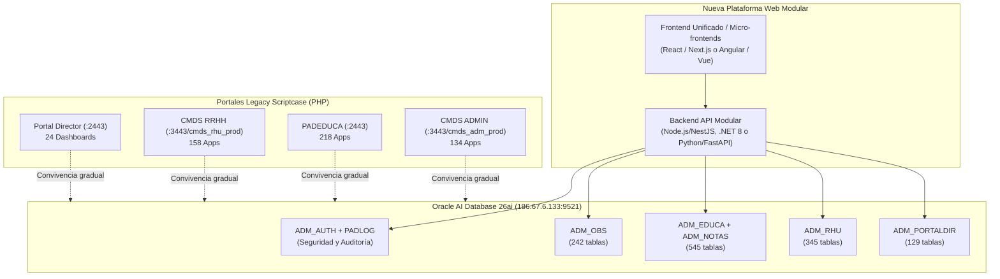

# 03. Estrategia y Arquitectura de Migración (Ecosistema Completo CMDS / PAD)

## 1. Mapa Consolidado del Ecosistema Legacy (Scriptcase + Oracle 26ai)

Tras completar el relevamiento integral en modo solo lectura de los **4 portales web activos** y los **11 esquemas de la base de datos Oracle (`186.67.6.133:9521 / cmdseducaprod`)**, el panorama completo del ecosistema es el siguiente:

| # | Sistema / Portal | URL Productiva | Esquema(s) Oracle | Tablas / Vistas | Apps Scriptcase | Estado y Prioridad de Migración |
| :-: | :--- | :--- | :--- | :---: | :---: | :--- |
| **1** | **CMDS ADMIN** *(Gestión Administrativa)* | `https://cmds.pad.cl:3443/cmds_adm_prod/login/` | `ADM_OBS` + `ADM_AUTH` + `ADM_CMDS` | 282 tablas 17 vistas | **134 apps** *(10 módulos priorizados)* | **Activo (2026)** — Documentado en [01-inventario-sistemas-y-pantallas.md](file:///c:/Users/rhormazabal/.gemini/antigravity/scratch/migracion-sistemas-pad/docs/01-inventario-sistemas-y-pantallas.md) y [02-diccionario-datos-y-trazabilidad.md](file:///c:/Users/rhormazabal/.gemini/antigravity/scratch/migracion-sistemas-pad/docs/02-diccionario-datos-y-trazabilidad.md). |
| **2** | **PADEDUCA** *(Gestión Escolar y Libro Digital)* | `https://cmds.pad.cl:2443/login/` | `ADM_EDUCA` + `ADM_NOTAS` *(auxiliar)* | 545 tablas 112 vistas | **218 apps** *(106 con uso activo)* | **Activo Crítico (2026)** — >150M filas. Documentado en [04-levantamiento-adm-educa.md](file:///c:/Users/rhormazabal/.gemini/antigravity/scratch/migracion-sistemas-pad/docs/04-levantamiento-adm-educa.md). |
| **3** | **CMDS RRHH** *(Personal y Remuneraciones)* | `https://cmds.pad.cl:3443/cmds_rhu_prod/login/` | `ADM_RHU` | 345 tablas 30 vistas | **158 apps** *(113 con uso histórico)* | **Activo Parcial (2026)** — Ficha Personal, Carrera Funcionaria y Bolsa de Trabajo activos en 2026. Documentado en [05-levantamiento-adm-rhu.md](file:///c:/Users/rhormazabal/.gemini/antigravity/scratch/migracion-sistemas-pad/docs/05-levantamiento-adm-rhu.md). |
| **4** | **Portal Director** *(BI / Control Escolar)* | `https://cmds-portal-director.pad.cl:2443/login/` | `ADM_PORTALDIR` | 129 tablas 59 vistas | **24 dashboards** | **Activo Crítico (2026)** — Uso diario hasta nov-2026. Documentado en [06-levantamiento-adm-portaldir-y-admeta.md](file:///c:/Users/rhormazabal/.gemini/antigravity/scratch/migracion-sistemas-pad/docs/06-levantamiento-adm-portaldir-y-admeta.md). |
| **5** | **ENCUESTAS** *(`ADMETA`)* | *(Integrado con `ADM_AUTH`, `SIST_ID=21`)* | `ADMETA` | 75 tablas 10 vistas | **36 apps** | **Secundario / Bajo Uso** — Sistema de encuestas normales/anónimas (54k respuestas). Documentado en [06-levantamiento-adm-portaldir-y-admeta.md](file:///c:/Users/rhormazabal/.gemini/antigravity/scratch/migracion-sistemas-pad/docs/06-levantamiento-adm-portaldir-y-admeta.md). |
| **6** | **Portal del Trabajador / Tótem** | — | `ADM_TOTEM` | 11 tablas | — | **Ya migrado** *(confirmado por el usuario)*. |
| **7** | **Esquemas Transversales** | — | `ADM_AUTH`, `PADLOG`, `ADM_PROC_BE` | 29 tablas | — | Autenticación centralizada, auditoría de logs y monitoreo de jobs backend. |

---

## 2. Diagnóstico Técnico Transversal

1. **Alto acoplamiento en la capa de presentación (Scriptcase):**
   - Entre los 4 portales activos suman **534 aplicaciones Scriptcase** (`134` en `ADM_OBS` + `218` en `ADM_EDUCA` + `158` en `ADM_RHU` + `24` en `ADM_PORTALDIR`) que se comunican por variables de sesión PHP e `iframes` anidados.
   - Debido a la arquitectura de Scriptcase (donde una sola pantalla funcional requiere `dashboard_blank` + `control` + `grid` + `form`), las **534 micro-aplicaciones equivalen en realidad a ~120 vistas modernas** bien consolidadas.
2. **Base de datos sólida y bien estructurada en Oracle 26ai (`1.376 tablas` y `228 vistas` en total):**
   - Toda la lógica de datos, catálogos (`OBS_REF_CODES`, `RHU_APP_DOMAINS`, `PDIR_DOMINIOS`), menús por perfil (`OBS_MENU`, `EDC_APLICACIONES`, `RHU_MENU_APP_V`, `PDIR_APPS`) y procesos pesados (`PDIR_PROC_CARGAS`) ya viven en Oracle.
   - Esto permite aplicar el patrón **Strangler Fig (Migración Incremental sin Big Bang)**: el nuevo frontend/backend puede leer y escribir directamente sobre los mismos esquemas Oracle mientras se apagan progresivamente los módulos en Scriptcase.

---

## 3. Estrategia y Hoja de Ruta Global de Migración

### Bloque A: `CMDS ADMIN` (`ADM_OBS`) — 5 Fases Incrementales
| Fase | Módulos Incluidos | Tablas Clave (`ADM_OBS`) | Entregables Clave |
| :--- | :--- | :--- | :--- |
| **Fase A0: Core + Auth + Mantenedor** | Login (`ADM_AUTH`) + **4. Mantenedor General** (`MENU_ID = 5`) | `AUT_USUARIOS`, `OBS_MENU*`, `OBS_REF_CODES`, `OBS_PARAMETROS`, `ADM_*` | Base transversal de autenticación, menú dinámico por rol y catálogos maestros. |
| **Fase A1: Boletas de Honorarios y Evidencias** | **1. Boleta Honorarios** (`MENU_ID = 2`) + **7. Evidencia** (`MENU_ID = 890`) | `BHO_BOLETAS`, `BHO_FLUJO_ESTADO`, `BHO_EVIDENCIA*`, `ADM_REPORTE_SOFTLAND` | Flujo completo de boletas (48,5k registros), evidencias (62,8k docs) e interfaces Softland/Servipag/Transparencia. |
| **Fase A2: Gestión Documental y Órdenes de Servicio** | **2. Oficina de Partes** (`MENU_ID = 3`) + **3. Orden de Servicio** (`MENU_ID = 1210`) | `OPA_DOCUMENTOS`, `OPA_FLUJO`, `OPA_MOV_DOCUMENTOS`, `OPA_ORDEN_SERVICIO*` | Recepción, derivación, valorados y seguimiento de Órdenes de Servicio. |
| **Fase A3: Compras y Mercado Público** | **6. Hoja de Ruta** (`MENU_ID = 81`) + **8. Mercado Público** (`MENU_ID = 1371`) | `HR_INICIATIVA`, `HR_HOJA_RUTA`, `HR_DISPONIBILIDAD_PPTO`, `MPU_ORDENES_*` | Ciclo de compras, CDP e integración con API Mercado Público (`appl.pad.cl:12000`). |
| **Fase A4: Operaciones, RRHH APS y Agenda** | **5. Mantenimiento Obras** + **9. RRHH APS** + **10. Agenda Atención** | `OTR_ORDEN_TRABAJO*`, `CONTRATO`, `REGISTRO`, `OBS_DATOS_SOLICITUD` | Cierre de los 10 módulos priorizados de `CMDS ADMIN`. |

### Bloque B: `Portal Director` (`ADM_PORTALDIR`) — Quick Win Analítico
- **Por qué abordarlo temprano:** Es **100% de solo lectura** (24 tableros sobre las 59 vistas `PDIR_*` ya pre-calculadas en Oracle), tiene altísima visibilidad ejecutiva (usado a diario por Directores y Sostenedor hasta nov-2026) y **cero riesgo transaccional**.
- Sus 24 aplicaciones Scriptcase pueden reemplazarse por **5 tableros ejecutivos interactivos** conectados directamente a las vistas `PDIR_*`.

### Bloque C: `CMDS RRHH` (`ADM_RHU`) — Migración Selectiva por Uso Vigente
- **Fase C1 (Módulos Activos en 2026):** Migrar **Ficha Personal (`ficha_personal_grid`)**, **Carrera Funcionaria y Capacitación (`carrera_funcionaria_grid`, `capacitacion_individual_grid`)**, **Reclutamiento / Bolsa de Trabajo (`BTR_*`)**, **Contratos Pendientes** y **Anticipos**.
- **Fase C2 (Consulta Histórica / Remuneraciones):** Habilitar visor de solo lectura para las `650.351` liquidaciones históricas (`RHU_LIQUIDACION_TRAB`), Certificados de Renta y Licencias Médicas (`RHU_LICE_*`), validando con RRHH cuáles procesos de cálculo siguen realizándose en `ADM_RHU`.

### Bloque D: `PADEDUCA` (`ADM_EDUCA` + `ADM_NOTAS`) — Migración por Dominio Escolar
- **Fase D1 (Establecimiento, Matrícula, Ficha Alumno y Certificados):** Administración de cursos, horarios, inscripción/matrícula, fichas y emisión de certificados verificados (`EDC_DOCTO_VERIFICADO` + `ADM_NOTAS.EDC_NOTAS_CERTIFICADO_V`).
- **Fase D2 (Libro de Clases Digital y Firma con Token):** Asistencia por bloque/diaria (`EDC_ASISTENCIA_BLOQUE`), Leccionario (`EDC_LECCIONARIO_CLASES`), Notas (`EDC_NOTAS_ASIG_CURSO`), Educación Parvularia y firma digital (`EDC_TOKEN_*`).
- **Fase D3 (PIE, Convivencia, Dual TP e Interoperabilidad SIGE MINEDUC):** Subsistema PIE (`57 tablas PIE_*`), casos de convivencia escolar y conector SOAP con MINEDUC (`EDC_SIGE_*`).
