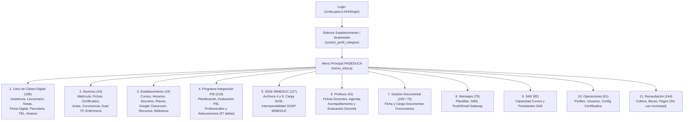

# 04. Levantamiento Técnico y Funcional — `ADM_EDUCA` (PADEDUCA) y Esquema Auxiliar `ADM_NOTAS`

## 1. Resumen Ejecutivo

- **Nombre del Sistema:** `PADEDUCA` (Gestión Escolar y Libro de Clases Digital)
- **URL Productiva:** `https://cmds.pad.cl:2443/login/` (redirige post-login al selector de perfil/establecimiento `/control_perfil_colegios/` y luego a `/menu_educa/`)
- **Esquema Principal en Oracle:** `ADM_EDUCA` (**528 tablas**, **108 vistas**, **922 constraints**)
- **Esquema Auxiliar Vinculado:** `ADM_NOTAS` (**17 tablas**, **4 vistas** — utilizado para pre-cálculo y emisión de certificados de notas)
- **Total de Aplicaciones en Catálogo (`EDC_APLICACIONES`):** **218 entradas de menú/aplicaciones** (de las cuales **106 aplicaciones** registran actividad directa en la tabla de auditoría `EDC_TRACE_APLIC_LOG$_11`).
- **Volumetría Destacada:** Es el esquema de mayor volumen transaccional de toda la corporación, superando los **150 millones de registros** acumulados (incluyendo **105,2 millones** en `EDC_ASISTENCIA_BLOQUE`, **8,2 millones** en `EDC_ASISTENCIA_CURSO`, **7,94 millones** en `EDC_NOTAS_ASIG_CURSO`, **5,28 millones** en firmas digitales `EDC_TOKEN_*` y **2,88 millones** en `EDC_LECCIONARIO_*`).

---

## 2. Arquitectura Funcional y Mapa de Módulos (`EDC_APLICACIONES`)

El menú principal de `ADM_EDUCA` se organiza en **11 módulos funcionales** parametrizados en la tabla `ADM_EDUCA.EDC_APLICACIONES` y perfilados por establecimiento mediante `EDC_PERFILES`, `EDC_APLI_PERFIL` y `EDC_USUARIOS_ESTAB`:

---

## 3. Inventario Detallado de Módulos y Pantallas (`ADM_EDUCA`)

### 3.1. Módulo: Libro de Clases Digital (`APLI_COD = 186`)
Es el núcleo operativo diario de los establecimientos educacionales, regulado por las exigencias de la Superintendencia de Educación y MINEDUC (Circular N° 30).

| Submódulo | Cód. | Opción de Menú | Aplicación Scriptcase (`APLI_LINK`) | Usos (`LOG$_11`) | Tablas Oracle Asociadas |
| :--- | :---: | :--- | :--- | :---: | :--- |
| **Asistencia** | `1` | Ingreso de Asistencia por Asignatura | `control_mantenedor_ingreso_asistencia` | **517.874** | `EDC_ASISTENCIA_BLOQUE`, `EDC_ASISTENCIA_BLOQUE_OBS`, `EDC_TOKEN_ASBL` |
| **Asistencia** | `2` | Consulta de Asistencia por Asignatura | `control_reporte_asistencia_mensual` | **59.438** | `EDC_ASISTENCIA_BLOQUE`, `EDC_RESUMEN_ESTADO_ASBL` |
| **Asistencia** | `23` | Consulta de Asistencia Diaria/Mensual | `control_reporte_asistencia_diaria` | **55.111** | `EDC_ASISTENCIA_CURSO`, `EDC_RESUMEN_ESTADO_ASDI` |
| **Asistencia** | `62` | Ingreso de Asistencia Mensual | `control_mantenedor_asistencia_mensual` | **13.411** | `EDC_ASISTENCIA_CURSO` |
| **Asistencia** | `26` | Ingreso de Porcentaje Asistencia | `blank_dashboard_asistencia_porcentaje` | 761 | `EDC_ASIST_CURSO_PORC` |
| **Asistencia** | `22` | Ingreso de Asistencia Diaria | `control_mantenedor_ingreso_asistencia_diaria_v2` | 0* | `EDC_ASISTENCIA_CURSO` |
| **Asistencia** | `229` | Registro Asistencia Ingreso Posterior | `blank_dashboard_registro_posterior` | 0* | `EDC_ASISTENCIA_BLOQUE_LOG` |
| **Notas** | `99` | Informe de Notas Anual Por Alumno | `control_reporte_concentracion_notas_anual` | **83.676** | `EDC_NOTAS_ASIG_CURSO`, `EDC_PROMEDIO_FINAL_ASIG` |
| **Notas** | `20` | Informe Parcial Notas Por Alumno | `control_reporte_concentracion_notas` | **68.841** | `EDC_NOTAS_ASIG_CURSO`, `EDC_DETA_INF_NOTA_X_ASIG_V` |
| **Notas** | `17` | Ingreso de Notas | `blank_dashboard_ingreso_notas` | **33.575** | `EDC_NOTAS_ASIG_CURSO`, `EDC_EVALUACIONES_CURSO` |
| **Notas** | `30` | Informe de Notas por Periodo | `blank_dashboard_informe_notas_semestral` | **1.904** | `EDC_NOTAS_ASIG_CURSO`, `EDC_PROMEDIO_PERIODO` |
| **Notas** | `167` | Definición de Evaluaciones | `dashboard_info_notas_blank` | — | `EDC_EVALUACIONES_CURSO` |
| **Notas** | `168` | Ponderación de Notas | `dashboard_blank_ponderacion_notas` | — | `EDC_PONDERACION_NOTAS` |
| **Notas** | `192` | Solicitud Cambio de Notas | `dashboard_ingreso_solicitud_blank` | — | `EDC_SOLICITUD_CAMBIO_NOTA` |
| **Notas** | `193` | Aprobación Solicitudes Cambio de Notas | `dashboard_validar_solicitud_blank` | — | `EDC_SOLICITUD_CAMBIO_NOTA` |
| **Leccionario** | `171` | Registro de Contenido Leccionario | `dashboard_blank_registro_leccionario` | — | `EDC_LECCIONARIO_CLASES`, `EDC_TOKEN_LECCIONARIO`, `EDC_RESUMEN_ESTADO_LENO` |
| **Leccionario** | `172` | Reporte de Registro Leccionario | `dashboard_reporte_leccionario_blank` | — | `EDC_LECCIONARIO_CLASES` |
| **Ed. Parvularia** | `203` | Ingreso Registro Diario Parvularia | `dashboard_leccionario_parvulo_blank` | — | `EDC_LECCIONARIO_PARV`, `EDC_TOKEN_LECCION_PARV`, `EDC_RESUMEN_ESTADO_LEPA` |
| **Ed. Parvularia** | `204` | Reporte Registro Diario Parvularia | `dashboard_reporte_lecc_parvulo` | — | `EDC_LECCIONARIO_PARV` |
| **Firma Digital** | `205` | Revisión Firma Digital Asistencia | `blank_dashboard_resumen_asis` | — | `EDC_TOKEN_ASBL`, `EDC_RESUMEN_ESTADO_ASBL` |
| **Firma Digital** | `206` | Revisión Firma Digital Leccionario | `blank_dashboard_resumen_lecc` | — | `EDC_TOKEN_LECCIONARIO`, `EDC_RESUMEN_ESTADO_LENO` |
| **Firma Digital** | `215` | Revisión Firma Digital Atrasos | `blank_dashboard_firma_digital_atrasos` | — | `EDC_CTRL_ATRASOS_ALUMNOS`, `EDC_TOKEN_*` |
| **Anotaciones** | `54` | Registro de Anotaciones | `blank_dashboard_modulo_anotaciones` | **5.847** | `EDC_ANOTACIONES_ALUMNO` |
| **Anotaciones** | `55` | Consulta de Anotaciones | `blank_dashboard_consulta_anotaciones` | **2.608** | `EDC_ANOTACIONES_ALUMNO` |
| **Salidas / Atrasos** | `44` | Registro de Salida de Alumnos | `blank_dashboard_modulo_salida` | 353 | `EDC_CTRL_HORARIO_SALIDA`, `EDC_CTRL_HORA_SALI_DOCTO` |
| **Salidas / Atrasos** | `183` | Registro de Salida de Cursos | `salidas_curso_grid` | — | `EDC_SALIDA_CURSO` |
| **Salidas / Atrasos** | `212` | Registro de Atraso por Alumno | `blank_dashboard_registro_atrasos` | — | `EDC_CTRL_ATRASOS_ALUMNOS` |
| **Citación Apod.** | `178` | Registro de Citación Apoderados | `citacion_buscar_blank` | 246 | `EDC_CITACION_APODERADO` |
| **Módulo TEL** | `225` | Registro Fonoaudiológico (TEL) | `blank_dashboard_registro_fono` | — | `EDC_LCD_*` / Tablas TEL |
| **Bloqueos** | `228` | Bloqueo de Asistencia | `blank_bloqueo_asistencia_estab` | — | `EDC_BLOQUEO_ASIST_ESTAB`, `EDC_BLOQUEO_ASIST_EXCEP` |
| **MINEDUC LCD** | `101` | Generación de Archivo MINEDUC | `iniciar_lb_blank` | — | `EDC_LCD_ARCH_01` .. `EDC_LCD_ARCH_19` |

*(Nota: Las aplicaciones tipo `dashboard_blank_*` delegan en sub-aplicaciones `form_*` y `grid_*` internas que registran cientos de miles de usos adicionales en `EDC_TRACE_APLIC_LOG$_11`, como `ingreso_asistencia_por_bloque_form` con 299.137 usos, `menu_educa` con 154.093 usos y `control_perfil_colegios` con 144.661 usos).*

---

### 3.2. Módulo: Alumnos (`APLI_COD = 43`)

| Submódulo | Cód. | Opción de Menú | Aplicación Scriptcase (`APLI_LINK`) | Usos (`LOG$_11`) | Tablas Oracle Asociadas |
| :--- | :---: | :--- | :--- | :---: | :--- |
| **Matrícula** | `195` | Inscripción de Alumnos | `form_inscripcion_alumnos` | **1.548** | `EDC_FICHA_ALUMNO`, `EDC_CONTACTO_ALUMNOS` |
| **Matrícula** | `197` | Listado de Alumnos Inscritos | `blank_dashboard_inscripcion` | — | `EDC_FICHA_ALUMNO` |
| **Matrícula** | `198` | Matrícula de Alumnos | `blank_dashboard_matricula` | — | `EDC_MATRICULA_ALUMNO`, `EDC_ALUMNOS_CURSOS` |
| **Matrícula** | `199` | Listado de Alumnos Matriculados | `blank_dashboard_lista_matriculados` | — | `EDC_MATRICULA_ALUMNO` |
| **Ficha y Promoción** | `13` | Fichas de Alumnos | `grid_mantenedor_alumno` | — | `EDC_FICHA_ALUMNO`, `EDC_FICHA_ALUM_FOTOS` |
| **Ficha y Promoción** | `31` | Promoción Manual de Alumnos | `control_mantenedor_promocion_alumnos` | **1.496** | `EDC_PROMEDIO_FINAL_ASIG`, `EDC_SITUACION_FINAL` |
| **Gestión y Actas** | `32` | Acta de Calificaciones | `control_acta_calificaciones` | **6.347** | `EDC_PROMEDIO_FINAL_ASIG`, `EDC_ACTA_CALIFICACIONES` |
| **Gestión y Actas** | `39` | Lista Curso | `control_lista_curso` | **2.631** | `EDC_ALUMNOS_CURSOS` |
| **Gestión y Actas** | `58` | Informe de Situación Anual | `blank_dashboard_informe_situacion` | 948 | `EDC_SITUACION_FINAL` |
| **Gestión y Actas** | `71` | Informe de Situación por Periodo | `blank_dashboard_informe_situacion_periodo` | 259 | `EDC_PROMEDIO_PERIODO` |
| **Gestión y Actas** | `83` | Lista Alumnos PIE | `grid_listado_alumnos_pie` | 75 | `PIE_EST_PERSONAS` |
| **Gestión y Actas** | `34` | Licencias de Educación | `blank_dashboard_licencia_basica` | 45 | `EDC_CERTIFICADOS_ESTAB_V` |
| **Gestión y Actas** | `143` | Libro de Registro (Matrícula) | `control_libro_registro` | 43 | `EDC_MATRICULA_ALUMNO` |
| **Certificados** | `36` | Certificado de Alumno Regular | `blank_dashboard_alumno_regular` | **1.049** | `EDC_CERTIFICADOS_ESTAB_V`, `EDC_DOCTO_VERIFICADO` |
| **Certificados** | `35` | Certificado de Estudios | `blank_dashboard_certificado_estudios` | 107 | `EDC_CERTIF_NOTAS_ALUM_V`, `ADM_NOTAS.EDC_NOTAS_CERTIFICADO_V` |
| **Certificados** | `37` | Certificado de Asistencia | `blank_dashboard_informe_asistencia` | 78 | `EDC_ASISTENCIA_CURSO` |
| **Certificados** | `218` | Generación Masiva Promoción Año Ant. | `control_gen_masiva_doc_promocion` | 37 | `EDC_DOCTO_VERIFICADO` |
| **Certificados** | `38` | Certificado de Matrícula | `blank_dashboard_informe_matricula` | 16 | `EDC_MATRICULA_ALUMNO` |
| **Certificados** | `184` | Certificado Retiro de Alumno | `filtro_certificado_retiro_alumno_control` | — | `EDC_ASIST_RESPALDO_RETIRO` |
| **Certificados** | `185` | Certificado Aceptación Baja Matrícula | `filtro_certificado_baja_alumno_control` | — | `EDC_MATRICULA_ALUMNO` |
| **Inf. Personalidad** | `46` | Evaluar Alumnos | `blank_dashboard_contestar_evaluacion` | **1.195** | `EDC_RESPUESTA_EVIN` (3,33M filas) |
| **Inf. Personalidad** | `40` | Crear Informe Personalidad | `grid_informes_establecimiento` | 430 | `EDC_INFORME_PERSONALIDAD` |
| **Inf. Personalidad** | `53` | Consulta Informes por Alumno | `blank_dashboard_consultar_evaluacion` | 254 | `EDC_RESPUESTA_EVIN` |
| **Inf. Personalidad** | `74` | Impresión Masiva Informes | `grid_impresion_masiva` | 171 | `EDC_RESPUESTA_EVIN` |
| **Convivencia** | `106` | Ingreso de Caso Convivencia | `casos_grid` | — | `EDC_CASOS_ALUMNOS`, `EDC_CASOS_ESTAB`, `EDC_CASOS_ACCIONES` |
| **Convivencia** | `114` | Seguimiento de Mis Casos | `casos_supervisor_grid` | — | `EDC_CASOS_ALUM_ACCION` |
| **Formación Dual TP**| `175` | Centros de Prácticas TP | `empresa_estab_grid` | — | `EDC_CONTACTO_EMPR` |
| **Formación Dual TP**| `176` | Registro Práctica Alumno | `practica_grid` | — | `EDC_PRACTICA_ALUMNO` |
| **Electivos** | `189` | Creación de Grupos Diferenciales | `listado_mantenedor_asign_selectiva_grid` | — | `EDC_ASBL_ASIG_ELECTIVA` (873k filas) |
| **Salud Escolar** | `52` | Enfermería y Control Sano | `blank_dashboard_modulo_enfermeria` | 3 | `EDC_ATENCION_ENFER_GRCU_V` |
| **Salud Escolar** | `98` | Declaración Accidente Escolar | `declaracion_individual` | — | `EDC_ACCIDENTE_ESCOLAR` |

---

### 3.3. Módulos: Establecimiento (`19`), Profesor (`41`), PIE (`216`), SIGE (`117`), Mensajes (`79`), SAE (`82`) y Operaciones (`61`)

| Módulo | Cód. | Opción de Menú | Aplicación Scriptcase (`APLI_LINK`) | Usos (`LOG$_11`) | Tablas / Integraciones Clave |
| :--- | :---: | :--- | :--- | :---: | :--- |
| **Establecimiento** | `8` | Administración de Cursos | `grid_GRADOS_CURSOS` | **3.342** | `EDC_GRADOS_CURSOS`, `EDC_CURSO_ASIGNATURA`, `EDC_CURSO_PROFESORES` |
| **Establecimiento** | `11` | Cursos Establecimiento | `grid_mantenedor_grados_establecimiento` | 545 | `EDC_GRADOS_ESTAB` |
| **Establecimiento** | `12` | Ficha Establecimiento | `grid_mantenedor_establecimiento` | 207 | `EDC_ESTAB_EDUCA`, `EDC_CONTACTO_ESTAB` |
| **Establecimiento** | `159` | Horario (Bloques, Plantilla, Curso) | `grid_tipos_bloques`, `grid_cabecero_horario`, `grid_asignar_horario_curso` | 22 | `EDC_HORARIO_CAB`, `EDC_HORARIO_DET`, `EDC_TIPOS_BLOQUES` |
| **Establecimiento** | `169` | Parametrización de Promedios | `blank_parametrizacion` | — | `EDC_PAR_PROM_TIEN`, `EDC_PAR_PROM_GRCU_ASIG` |
| **Establecimiento** | `129` | Google Classroom | `grid_mantenedor_establecimiento_classroom`, `grid_GRADOS_CURSOS_classroom` | — | Sincronización de cursos y métricas con Google Classroom |
| **Establecimiento** | `90` | Reserva de Recursos y Biblioteca | `blank_dashboard_agenda_recursos`, `grid_libros_establecimiento` | 109 | `EDC_INVENTARIO_RECURSOS`, `EDC_BIBLIOTECA_ALUMNOS_V` |
| **Profesor** | `14` | Fichas de Profesores | `grid_mantenedor_profesores` | **1.179** | `EDC_FICHA_PROFESORES`, `EDC_CURSO_PROFESORES` |
| **Profesor** | `123` | Acompañamiento Docente | `grid_plan_evaluacion_docente`, `blnk_evaluar_docente` | 3 | Evaluación y acompañamiento pedagógico en aula |
| **PIE** | `217` | Documento Planificación y Evaluación | `blank_integracion_pie` | — | **57 tablas `PIE_*`** (`PIE_EST_*`, `PIE_TOKEN_*`) |
| **PIE** | `236` | Registro PIE por Curso | `app_dashboard_registro_por_curso_blank` | — | `PIE_EST_FLEX_CUR`, `PIE_EST_RESP_DIVE_A_DET`, `PIE_TOKEN_EQUI_AULA` |
| **SIGE MINEDUC** | `33` | Generador Archivos 4 y 5 | `control_archivo_sige` | **670** | `EDC_ARCH_LINEAS` (858k filas) |
| **SIGE MINEDUC** | `221` | Interoperabilidad SIGE | `tabs_menu_interoperabilidad` | — | `EDC_SIGE_ASISTENCIA_OUT`, `EDC_SIGE_ERROR_ENVIO` (3,01M filas) |
| **Gestión Doc.** | `231` | Ficha y Carga Documentos Funcionario | `blank_adm_ficha_carga_doctos_func` | — | `EDC_ADM_FUNCIONARIOS`, `EDC_ADM_DOCTO_X_FUNC` |
| **Mensajes** | `80` | Configuración y Plantillas Mensajes | `grid_mensajes`, `grid_plantilla_mensajes`, `compra_sms_grid` | 188 | Gateway HTTP `http://appl.pad.cl:8380/messaging/sendMessage` |
| **SAE** | `86` | Gestión Postulantes y Capacidad SAE | `grid_alumnos_postulantes`, `grid_consulta_capacidad_cursos_SAE` | 4 | `EDC_POSTULACION_PORTAL`, `EDC_ALUMNOS_CURSOS_SAE_V` |
| **Operaciones** | `3` | Perfilamiento y Usuarios Portal | `grid_mantenedor_usuarios_portal`, `grid_mantenedor_usuarios`, `grid_usuarios_establecimiento` | **2.198** | `EDC_USUARIOS`, `EDC_PERFILES`, `EDC_DOCTO_VERIFICADO` |

---

## 4. Modelo de Datos de `ADM_EDUCA` (528 Tablas y 108 Vistas)

Las 528 tablas de `ADM_EDUCA` se agrupan en **12 dominios de datos**:

| Dominio / Prefijo | N° Tablas | Filas Totales | Tablas Principales | Propósito en el Negocio |
| :--- | :---: | :---: | :--- | :--- |
| **`EDC_ASISTENCIA_*` / `EDC_ASIST_*`** | 12 | **115.117.893** | `EDC_ASISTENCIA_BLOQUE` (105,2M), `EDC_ASISTENCIA_CURSO` (8,2M), `EDC_ASISTENCIA_BLOQUE_LOG` (1,02M) | Asistencia diaria y por bloque horario de cada alumno en cada establecimiento. |
| **`EDC_NOTAS_*` / `EDC_PROMEDIO_*`** | 14 | **11.150.000+** | `EDC_NOTAS_ASIG_CURSO` (7,94M), `EDC_PROMEDIO_FINAL_ASIG` (2,56M), `EDC_ASBL_ASIG_ELECTIVA` (873k) | Calificaciones parciales, promedios semestrales/trimestrales, notas diferenciales y promedios finales. |
| **`EDC_TRACE_*`** | 12 | **10.236.409** | `EDC_TRACE_APLIC_LOG$_01` a `$_12` | Bitácora particionada por mes de cada acceso a aplicaciones Scriptcase. |
| **`EDC_TOKEN_*` / `EDC_RESUMEN_ESTADO_*`** | 26 | **9.555.430** | `EDC_TOKEN_ASBL` (2,66M), `EDC_TOKEN_LECCIONARIO` (1,89M), `EDC_RESUMEN_ESTADO_ASBL` (2,60M), `EDC_RESUMEN_ESTADO_LENO` (1,51M) | Firmas digitales con token (OTP/Firma Libro Digital) de profesores para asistencia y leccionario, y estados de cumplimiento. |
| **`EDC_SIGE_*` / `EDC_ARCH_*`** | 23 | **4.332.496** | `EDC_SIGE_ERROR_ENVIO` (3,01M), `EDC_ARCH_LINEAS` (858k), `EDC_SIGE_ASISTENCIA_OUT`, `EDC_SIGE_TIMES` | Cola de envío de asistencia y matrículas vía SOAP al SIGE de MINEDUC y generación de Archivos planos 4 y 5. |
| **`EDC_RESPUESTA_EVIN` (Personalidad)** | 6 | **3.339.727** | `EDC_RESPUESTA_EVIN` (3,33M) | Evaluaciones de informes de personalidad y desarrollo escolar por alumno. |
| **`EDC_LECCIONARIO_*`** | 4 | **2.884.070** | `EDC_LECCIONARIO_CLASES` (1,99M), `EDC_LECCIONARIO_CLASES_LOG`, `EDC_LECCIONARIO_PARV` | Contenidos pasados en cada bloque de clases (enseñanza básica/media y educación parvularia). |
| **`EDC_LCD_*`** | 53 | **1.754.178** | `EDC_LCD_ARCH_01` a `EDC_LCD_ARCH_19` (`EDC_LCD_ARCH_15` con 1,72M) | Tablas estructuradas de exportación normativa del Libro de Clases Digital para fiscalización MINEDUC/SuperEduc. |
| **`EDC_DOCTO_*`** | 9 | **1.037.003** | `EDC_DOCTO_VERIFICADO`, `EDC_DOCTO_VERIF_ARCH`, `EDC_DOCTO_LOG` | Certificados emitidos con código de verificación QR/Folio y sus respaldos PDF. |
| **`EDC_ESTAB_*` / `EDC_DATO_*` / `EDC_PLANI_*`** | 71 | **817.686** | `EDC_ESTAB_PROG_INDICADORES`, `EDC_ESTAB_PROG_OBJETIVOS`, `EDC_CURSO_ASIGNATURA` (281k) | Currículum nacional (Objetivos de Aprendizaje, Indicadores, Habilidades) instanciado por establecimiento y curso. |
| **`EDC_FICHA_*` / `EDC_CONTACTO_*` / `EDC_CASOS_*`** | 19 | **309.989** | `EDC_FICHA_ALUMNO` (152k), `EDC_CTRL_ATRASOS_ALUMNOS` (85k), `EDC_CONTACTO_ALUMNOS` (67k), `EDC_CASOS_ALUMNOS` | Ficha biopsicosocial del estudiante, apoderados, control de atrasos/salidas y casos de convivencia escolar. |
| **`PIE_*` (Programa Integración)** | 57 | **~1.500** | `PIE_EST_PERSONAS`, `PIE_EST_FLEX_CUR_ASIG`, `PIE_TOKEN_EQUI_AULA`, `PIE_TOKEN_REG_APOYO_EST` | Subsistema completo del Programa de Integración Escolar (Decreto 170 / Decreto 83) con su propio esquema de tokens de firma. |

---

## 5. Integraciones Externas Configuradas en `ADM_EDUCA`

Extraídas directamente de `EDC_PARAMETROS`, `EDC_PARAM_CORP` y `EDC_SIGE_PARAMETROS`:

1. **Web Services SOAP SIGE — MINEDUC (`EDC_SIGE_PARAMETROS`):**
   - **Semilla de Autenticación:** `http://w7app.mineduc.cl/WsApiAutorizacion/services/SemillaServiciosSoapPort`
   - **Envío de Asistencia y Reportes:** `http://w7app.mineduc.cl/WsApiMineduc/services/AsistenciaSigeSoapPort`
   - **Parámetro de activación masiva:** `MASIV_SIGE = SI`
2. **Almacenamiento y Token de Libro de Clases Digital (`EDC_PARAMETROS`):**
   - **Contexto:** `CONTEX_EDU_LD = CMDS`
   - **Rutas de Archivos:** `INPUT_LD = LIBRO_DIGITAL_ARCH/ede/input` y `OUTPUT_LD = LIBRO_DIGITAL_ARCH/ede/output`
   - **Directorio Oracle:** `PATH_CARGA_ARCH_DB = EDC_DIR_CARGA`
3. **Gateway de Mensajería SMS / Email / Push (`EDC_PARAM_CORP`):**
   - **Endpoint Interno:** `http://appl.pad.cl:8380/messaging/sendMessage` (cuenta `CMDS`).
4. **Google Classroom:**
   - Vinculación de establecimientos y cursos en `grid_mantenedor_establecimiento_classroom` y `grid_GRADOS_CURSOS_classroom`.

---

## 6. ¿Qué es el Esquema `ADM_NOTAS`? (Aclaración Técnica)

Durante el relevamiento consultaste qué era **`ADM_NOTAS`**. Al inspeccionar sus **17 tablas y 4 vistas** en Oracle, confirmamos que:

> [!IMPORTANT]
> **`ADM_NOTAS` NO es un sistema ni portal web independiente.** Es un **esquema auxiliar de procesamiento temporal (staging) y emisión histórica de Certificados de Notas** utilizado internamente por `ADM_EDUCA`.

### Evidencia en Base de Datos (`ADM_NOTAS`):
- **17 Tablas Temporales (`_TMP` y `_BKP`):**
  - `EDC_NOTAS_ALUMNOS_LOG_TMP` (1.060.847 filas)
  - `EDC_NOTAS_ALUMNOS_TMP` (353.232 filas) y sus respaldos `_BKP` a `_BKP_4` (~986.000 filas)
  - `EDC_FICHA_ALUMNO_TMP` (45.166 filas)
  - `EDC_ASISTENCIA_ALUM_TMP` (34.835 filas)
  - `EDC_ASIG_ORDEN_TMP` (4.509 filas), `EDC_USUARIOS_TMP` (1.410 filas), `EDC_PROFESORES_JEFES_TMP` (806 filas), `EDC_ASIGNATURAS_TMP` (411 filas), `EDC_DIRECTORES_ESTAB_TMP` (61 filas), `EDC_ESTAB_EDUCA_TMP` (53 filas).
- **4 Vistas de Consolidación:**
  - `EDC_NOTAS_CERTIFICADO_V`, `EDC_ASIGNATURAS_V`, `EDC_CURSOS_ESTAB_V`, `EDC_LETRA_CURSOS_V`.
- **Implicancia para la Migración:** No requiere migrar ninguna pantalla adicional; sus vistas/tablas son consumidas por el módulo de **Certificados de Estudios (`blank_dashboard_certificado_estudios`)** dentro de `ADM_EDUCA`.
