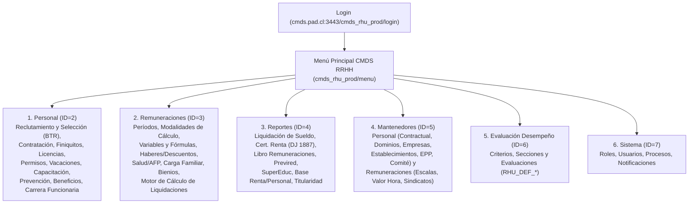

# 05. Levantamiento Técnico y Funcional — `ADM_RHU` (CMDS RRHH y Remuneraciones)

## 1. Resumen Ejecutivo

- **Nombre del Sistema:** `CMDS RRHH` (`SIST_ID = 41` en `ADM_AUTH.AUT_SISTEMAS`)
- **URL Productiva:** `https://cmds.pad.cl:3443/cmds_rhu_prod/login/` (redirige post-login a `/cmds_rhu_prod/menu/`)
- **Esquema en Oracle:** `ADM_RHU` (**345 tablas**, **30 vistas**, **412 constraints**)
- **Catálogo de Aplicaciones (`RHU_MENU_APP_V`):** **158 ítems de menú/aplicaciones**, de las cuales **113 aplicaciones** registran uso efectivo en la bitácora `RHU_LOG_APP`.
- **Catálogos Paramétricos (`RHU_APP_DOMAINS`):** **118 dominios** de negocio y **9 roles de seguridad** (`RHU_ROLES`: `REMUNERACIONES`, `ADMIN`, `JURID`, `FUNC`, `CARRERA FUNCIONARIA`, `RRHH_SALUD`, `RECLUTAMIENTO_SALUD`, `PERSONAL APS`, `TEST`).
- **Hallazgo Estratégico de Uso Real (`RHU_LOG_APP`):**
  - Los módulos de **Ficha de Personal (`ficha_personal_grid`)**, **Carrera Funcionaria y Capacitación Individual (`carrera_funcionaria_grid`, `capacitacion_individual_grid`)**, **Reclutamiento / Bolsa de Trabajo (`publicar_grid`, `buscar_postulante_grid`)**, **Anticipos (`anticipo_grid`)** y **Administración de Usuarios/Roles** registran actividad continua hasta **2026**.
  - Los submódulos de procesamiento masivo de **Remuneraciones** y **Licencias Médicas** muestran su mayor volumen histórico entre **2020 y 2024** (con `650.351` liquidaciones en `RHU_LIQUIDACION_TRAB`), lo que permite priorizar en una primera ola los módulos vigentes en 2026 y mantener las consultas históricas de liquidaciones/certificados en modo lectura.

---

## 2. Arquitectura Funcional y Mapa de Módulos (`RHU_MENU_APP_V`)

---

## 3. Inventario Detallado de Módulos y Pantallas (`ADM_RHU`)

### 3.1. Módulo: Personal (`APLI_ID = 2`)

| Submódulo | ID | Opción de Menú | Aplicación Scriptcase (`APLI_LINK`) | Usos (`RHU_LOG_APP`) | Último Uso | Tablas / Vistas Oracle Asociadas |
| :--- | :---: | :--- | :--- | :---: | :---: | :--- |
| **Contratación** | `58` | Ficha Personal | `ficha_personal_grid` | **6.164** | **2026-01-29** | `RHU_TRABAJADOR`, `RHU_CONTRATO`, `RHU_DOC_FICHA_TRAB_V` |
| **Contratación** | `60` | Contratos Pendientes | `contratos_pendientes_dashboard_blank` | 141 | **2025-01-24** | `RHU_CONTRATO`, `RHU_CONTRATO_MOV`, `RHU_APROBACION_CONT_V` |
| **Contratación** | `61` | Notificación Contrato | `contrato_notificaciones_dashboard_blank` | 32 | 2024-04-18 | `RHU_CONTRATO_NOTI` |
| **Contratación** | `144` | Carta Término | `dashboard_carta_termino_blank` | 8 | 2022-12-22 | `RHU_CONTRATO` |
| **Finiquito** | `11` | Finiquito | `Finiquito_grid` | 274 | 2024-04-18 | `RHU_FINIQUITO`, `RHU_CONTRATO_MOV` |
| **Carrera Func.** | `92` | Historial Carrera Funcionaria | `carrera_funcionaria_grid` | **2.305** | **2026-01-21** | `RHU_CARRERA_FUNCIONARIA`, `RHU_CARRERA_FUNC_HIST`, `RHU_DET_CARRERA_FUNC_HIST` |
| **Carrera Func.** | `91` | Capacitación Individual | `capacitacion_individual_grid` | 172 | **2026-01-21** | `RHU_CAPACITACION`, `RHU_PUNTAJE_INI_CF`, `RHU_PUNTAJE_ANUAL` |
| **Reclutamiento** | `57` | Buscar Postulante | `buscar_postulante_grid` | 154 | **2026-05-05** | `BTR_POSTULANTE`, `BTR_ARCHIVOS_POSTULANTE`, `BTR_ANT_ACADEMICOS`, `RHU_POS_*` |
| **Reclutamiento** | `56` | Publicar Oferta | `publicar_grid` | 117 | **2026-04-27** | `BTR_OFERTA`, `BTR_EE_POSTULACION` |
| **Reclutamiento** | `174` | Buscar Currículum / Personal APS | `dashboard_buscar_cv_blank` | — | — | `BTR_*` (30 tablas de Bolsa de Trabajo) |
| **Licencias Méd.** | `62` | Registrar Licencias | `dashboard_licencias_principal` | **549** | 2024-04-18 | `RHU_LICE_MEDICA`, `RHU_LICE_TRAB_INSTITUCION_V` |
| **Licencias Méd.** | `67` | Detalle de Carga Licencias | `archivos_grid` | 113 | 2024-02-12 | `RHU_TMP_LICE_PAGO` (349k filas), `LCS_PAGLIC` (108k filas) |
| **Licencias Méd.** | `69` | Estadísticas de Licencia | `dashboard_informe_estadisticas_licencias_blank` | 105 | 2020-10-22 | `RHU_LICE_MEDICA`, `RHU_ESTADOS_LCS` |
| **Licencias Méd.** | `68` | Licencias Pagadas | `dashboard_busqueda_lice_pagas_blank` | 91 | 2020-09-15 | `RHU_LICE_PAGO`, `RHU_LICE_PAGO_TOTAL_V` |
| **Licencias Méd.** | `64` | Informe Licencias Diarias | `dashboard_informe_licencias_blank` | 71 | 2022-08-29 | `RHU_LICE_MEDICA` |
| **Licencias Méd.** | `66` | Pagos de Licencia(s) | `abrir_carga_licencia` | 63 | 2023-04-27 | `RHU_LICE_PAGO`, `RHU_LICE_PAGO_RECH` |
| **Licencias Méd.** | `166` | Carga Estado Licencias | `principal_carga_masiva_lice_estado_blank` | 17 | 2023-04-27 | `RHU_ESTADOS_LCS` |
| **Licencias Méd.** | `63` | Licencias para Descuento | `dashboard_busqueda_lice_paradesc_blank` | 14 | 2023-04-27 | `RHU_LIME_DESCUENTO_V`, `RHU_LICE_NOTI` |
| **Permisos** | `70` | Solicitudes Permiso | `grid_permiso_principal` | 117 | 2024-08-07 | `RHU_PERMISO`, `RHU_PERMISO_MOV`, `RHU_PERMISO_COVID` |
| **Permisos** | `71` | Validación Permiso (Jefe Directo) | `permiso_principal_jefedirecto_grid` | 21 | 2022-08-22 | `RHU_PERMISO_MOV` |
| **Permisos** | `72` | Segunda Validación (SGE) | `permiso_principal_sge_grid` | 2 | 2022-06-22 | `RHU_PERMISO_MOV` |
| **Vacaciones** | `73` | Solicitudes Vacaciones | `vacaciones_grid` | 125 | 2024-04-18 | `RHU_VACA_TRAB_PERI`, `RHU_HIST_VACIONES_V` |
| **Vacaciones** | `74` | Validación Vacaciones (Jefe) | `vacaciones_jefedirecto_grid` | 90 | 2022-06-22 | `RHU_VACA_TRAB_PERI` |
| **Vacaciones** | `75` | Segunda Aprobación Vacaciones (SGE) | `vacaciones_sge_grid` | 12 | 2021-08-23 | `RHU_VACA_TRAB_PERI` |
| **Capacitación** | `76` | Iniciación / Crear / Asignar / Seguimiento Curso | `iniciacion_capacitacion_grid`, `grid_CAPACITACION_*` | 71 | 2022-11-17 | `RHU_CAPACITACION`, `RHU_CAPACITACION_MOV` (11,2M filas) |
| **Beneficios** | `90` | Asignar / Administrar Sala Cuna | `dashboard_busqueda_sala_cuna_blank`, `sala_cuna_grid` | 354 | 2020-12-30 | `RHU_SALA_CUNA`, `RHU_BENEF_CM`, `RHU_BENEF_MED` |
| **Bienestar / ODI**| `18-20`| Bienestar, ODI, Denuncia - Demanda | `bienestar_grid`, `ODI_GRID`, `denuncia_grid` | 107 | **2025-01-24** | `RHU_BIENESTAR_V`, `RHU_DENUNCIAS_V`, `RHU_DOC_DENUNCIA` |
| **Prevención** | `80-86`| Cursos Prevención, Entrega EPP, Comité, Accidentes | `entrega_epp_grid`, `grid_PREVENCION_REGISTRO_ACCIDENTE` | 13 | 2024-02-12 | `RHU_EPP_V`, `RHU_ACCIDENTE_V`, `RHU_DETALLE_ACCIDENTE` |

---

### 3.2. Módulo: Remuneraciones (`APLI_ID = 3`)

| Submódulo | ID | Opción de Menú | Aplicación Scriptcase (`APLI_LINK`) | Usos (`RHU_LOG_APP`) | Último Uso | Tablas Oracle Asociadas |
| :--- | :---: | :--- | :--- | :---: | :---: | :--- |
| **Haberes y Dctos.** | `102` | Proceso Carga Archivos H/D | `archivo_hd_grid` | **809** | 2024-02-12 | `RHU_TMP_HABER_DESCUENTO` (1,98M filas), `RHU_REMUN_NOVEDAD` |
| **Haberes y Dctos.** | `101` | Administrar Haberes y Descuentos | `cargar_habydesc_blank` | **427** | 2021-03-14 | `RHU_TMP_HABER_DESCUENTO` |
| **Salud / AFP** | `104` | Proceso Carga Archivos Salud-AFP | `archivos_SAF_grid` | 223 | 2021-03-15 | `RHU_TMP_SALUD_AFP` |
| **Salud / AFP** | `103` | Administrar Cambio Masivo Salud-AFP | `abrir_carga_SAF` | 86 | 2021-03-12 | `RHU_TMP_SALUD_AFP` |
| **Procesar Remun.** | `107` | Procesar Remuneraciones | `proceso_remu_grid` | 177 | 2023-03-22 | `RHU_LIQUIDACION_TRAB` (650k filas), `RHU_DETALLE_TRAB` (867k filas) |
| **Procesar Remun.** | `108` | Estadística de Liquidaciones | `graficas_blank` | 115 | 2023-03-22 | `RHU_LIQUIDACION_TRAB` |
| **Motor Variables** | `99` | Administrar Variables | `administrar_variables_grid` | 125 | 2023-07-25 | `RHU_VARIABLES`, `RHU_VARIABLES_ENUSO`, `RHU_VARIABLES_AGRUPADAS` |
| **Motor Variables** | `100` | Fórmulas de Cálculo | `formulas_grid` | 64 | 2023-07-25 | `RHU_VARIABLES`, `RHU_EMPRESA_MODCALC`, `RHU_EMPRESA_GRPVARIABLE` |
| **Motor Variables** | `23-27`| Período, Modalidad Cálculo, Grupos Variables, Variables Sistema | `periodo_grid`, `modalidad_calculo_form`, `grupos_variables_form`, `variables_sistema_grid` | 130 | 2024-03-21 | `RHU_PERIODO`, `RHU_VARIABLES_SISTEMA` |
| **Inst. Previsional**| `28` | Instituciones Previsionales | `rela_institucion_grid_new` | 34 | 2024-03-19 | `RHU_INST_PREV_PARAM` |
| **Cargas Familiares**| `130/31`| Asignación Familiar y Carga Familiar Masiva | `cargar_asig_blank`, `archivo_af_grid`, `cargar_fami_blank`, `archivo_f_grid` | 124 | 2021-03-15 | `RHU_TMP_CARGA_FAM`, `RHU_CARGA` |
| **Anticipos** | `93-95`| Solicitudes y Doble Validación Anticipo | `anticipo_grid`, `anticipo_jefedirecto_grid`, `anticipo_sge_grid` | 8 | **2026-01-27** | `RHU_ANTICIPOS_V` |
| **Bienios / Devol.** | `32/131`| Nómina Bienios y Devoluciones | `bienios_personal_grid`, `devolucion_grid` | 10 | 2024-01-12 | `RHU_LOG_BIENIOS` (500k filas), `RHU_DETALLE_DEVO` |

---

### 3.3. Módulos: Reportes (`4`), Mantenedores (`5`), Evaluación Desempeño (`6`) y Sistema (`7`)

| Módulo | ID | Opción de Menú | Aplicación Scriptcase (`APLI_LINK`) | Usos | Último Uso | Tablas Oracle Asociadas |
| :--- | :---: | :--- | :--- | :---: | :---: | :--- |
| **Reportes** | `172` | Titularidad Docente | `dashboard_titularidad_docente_principal` | 81 | 2023-11-09 | `RHU_CONTRATO`, `RHU_CARGA_HORARIA` |
| **Reportes** | `34/141`| Liquidación de Sueldo (Individual y por Período) | `liquidacion_sueldo_grid`, `resumen_liqui_blank` | 41 | 2024-05-30 | `RHU_LIQUIDACION_TRAB`, `RHU_DETALLE_TRAB` |
| **Reportes** | `36` | Libro de Remuneraciones | `libro_remuneraciones_grid` | 13 | 2024-04-01 | `RHU_LIQUIDACION_TRAB` |
| **Reportes** | `110/111`| Certificados de Renta (Trabajador y DJ 1887 Empresa) | `grid_RHU_CERTIFICADO_RENTA`, `certificado_1887_control` | 5 | 2024-05-30 | `RHU_BASERENTA_MV` (313k filas) |
| **Reportes** | `137` | Emitir Libro Superintendencia Educación | `reporte_supereduc_grid` | 2 | 2021-02-25 | `RHU_REPORTE_SUPEREDUC` |
| **Reportes** | `138` | Libro Previred | `reporte_previred_grid` | 2 | 2020-11-18 | `RHU_REPORTE_PREVIRED` |
| **Reportes** | `128/134`| Base Renta y Base Personal (Resumen / Extendido) | `base_renta_control`, `base_personal_control`, `base_personal_ext_control` | 13 | 2021-05-31 | `RHU_BASERENTA_MV`, `RHU_REPORTE_BASEPERSONAL` |
| **Mantenedores** | `38` | Dominios del Sistema | `dominio_grid` | **374** | 2024-09-24 | `RHU_APP_DOMAINS` (118 dominios) |
| **Mantenedores** | `150/37`| Contratos por Ley y Contractual | `mantenedor_contratos_ley_form`, `contractual_grid` | 70 | 2024-09-03 | `RHU_LEY_CONTRACTUAL`, `RHU_LEY_CAUSAL`, `RHU_LEY_JORNADA` |
| **Mantenedores** | `39/45/49`| Empresa, Establecimiento y Centro de Costo | `empresa_form`, `establecimiento_form`, `mantenedor_relacion_establecimiento_centro_form` | 47 | **2025-05-14** | `RHU_EMPRESA`, `RHU_ESTABLECIMIENTO` |
| **Mantenedores** | `116` | Firmas Digitales de Documentos | `personas_firmas` | 16 | **2025-05-14** | `RHU_FIRMA_PERSONA`, `RHU_FIRMA_DOC` |
| **Mantenedores** | `117-121`| Bienios, Bonos Responsabilidad, Escala Sueldos, Valor Hora Docente | `bienios_grid`, `bono_responsabilidad_form`, `escala_sueldo_grid`, `valor_hora_docente_grid` | 59 | 2021-02-01 | `RHU_ESC_SLDBS_SECTOR`, `RHU_ESC_BONORESPONSAB`, `RHU_ESC_FONDORETIRO`, `RHU_ESC_SLDBS_ASISEDUC` |
| **Eval. Desempeño**| `6` | Evaluación de Desempeño | `grid_RHU_EVALUACION` | — | — | `RHU_DEF_CRITERIO`, `RHU_DEF_SECCION`, `RHU_DEF_PREGUNTA`, `RHU_EVAL_DESEMPENO_V` |
| **Sistema** | `52/53` | Usuarios y Roles | `usuarios_grid`, `roles_grid` | **163** | **2026-04-21** | `RHU_USUARIOS`, `RHU_ROLES`, `RHU_ROLES_USUARIOS`, `RHU_ROLES_APLICACION` |
| **Sistema** | `54/55` | Procesos y Notificaciones | `sistemas_grid`, `noti_app_form` | 56 | 2024-02-19 | `RHU_PARAMETROS` |

---

## 4. Agrupación del Modelo de Datos en `ADM_RHU` (345 Tablas y 30 Vistas)

| Dominio / Prefijo | N° Tablas | Filas Totales | Tablas Principales | Propósito Funcional |
| :--- | :---: | :---: | :--- | :--- |
| **`RHU_ESTADOS` / `RHU_CAPACITACION*`** | 6 | **22.624.362** | `RHU_ESTADOS` (11,4M), `RHU_CAPACITACION_MOV` (11,2M), `RHU_CAPACITACION` (16,5k) | Trazabilidad de estados de procesos y movimientos de capacitación/carrera funcionaria. |
| **`RHU_TMP_*` (Cargas Masivas)** | 8 | **2.349.152** | `RHU_TMP_HABER_DESCUENTO` (1,98M), `RHU_TMP_LICE_PAGO` (349k), `RHU_TMP_CARGA_FAM`, `RHU_TMP_SALUD_AFP` | Staging de planillas masivas de remuneraciones, previsión y pagos de licencias. |
| **`RHU_LIQUIDACION_*` / `RHU_DETALLE_*` / `RHU_BASERENTA_*`** | 8 | **1.852.318** | `RHU_DETALLE_TRAB` (867k), `RHU_LIQUIDACION_TRAB` (650k), `RHU_BASERENTA_MV` (313k), `RHU_REMUN_NOVEDAD` (20,9k) | Liquidaciones históricas de sueldo, líneas de haberes/descuentos calculados y base de renta tributaria/previsional. |
| **`RHU_LOG_*`** | 3 | **521.031** | `RHU_LOG_BIENIOS` (500k), `RHU_LOG_APP`, `RHU_LOG_SESSION` | Auditoría de cálculo de bienios y accesos a pantallas del sistema. |
| **`RHU_LICE_*` / `LCS_*` (Licencias)** | 22 | **342.456** | `LCS_PAGLIC` (108k), `LCS_MAIL_BAD` (70,9k), `RHU_ESTADOS_LCS` (49,5k), `LCS_NO_LIC` (40,2k), `RHU_LICE_PAGO` (17k), `RHU_LICE_MEDICA` (16,7k) | Gestión integral de licencias médicas, descuentos, subsidios y recuperación de pagos desde Isapres/FONASA. |
| **`RHU_CONTRATO_*`** | 3 | **97.402** | `RHU_CONTRATO_MOV` (91,5k), `RHU_CONTRATO`, `RHU_CONTRATO_NOTI` | Contratos de trabajo (Docentes, Asistentes de la Educación, Salud APS, Administración Central) y sus anexos/movimientos. |
| **`RHU_CARRERA_*` / `RHU_PUNTAJE_*`** | 6 | **47.003** | `RHU_CARRERA_FUNCIONARIA`, `RHU_CARRERA_FUNC_HIST`, `RHU_DET_CARRERA_FUNC_HIST` (17,8k), `RHU_PUNTAJE_INI_CF` | Puntajes, niveles, bienios y progresión de la Carrera Funcionaria (especialmente Salud APS). |
| **`BTR_*` / `RHU_POS_*` (Bolsa de Trabajo)** | 37 | **11.847** | `BTR_CAPACITACIONES`, `BTR_ARCHIVOS_POSTULANTE`, `BTR_ANT_ACADEMICOS`, `BTR_EE_POSTULACION`, `RHU_POS_USUARIO` | Portal de Reclutamiento y Selección / Bolsa de Trabajo de la corporación. |
| **`RHU_VARIABLES_*` / `RHU_ESC_*` / `RHU_EMPRESA_*`** | 11 | **10.272** | `RHU_VARIABLES`, `RHU_VARIABLES_ENUSO`, `RHU_VARIABLES_SISTEMA`, `RHU_EMPRESA_MODCALC`, `RHU_ESC_SLDBS_SECTOR` | Motor de fórmulas, escalas de sueldo y reglas de cálculo por ley/sector. |
