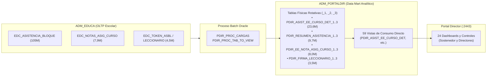

# 06. Levantamiento Técnico y Funcional — `ADM_PORTALDIR` (Portal Director) y Diagnóstico de `ADMETA`

## 1. Resumen Ejecutivo — `ADM_PORTALDIR` (Portal Director)

- **Nombre del Sistema:** `Portal Director` (Inteligencia de Negocios y Control de Gestión Escolar para Directores y Sostenedor)
- **URL Productiva:** `https://cmds-portal-director.pad.cl:2443/login/`
  - **Credencial Verificada:** Usuario `10633447` / Contraseña **`2114`** *(comparte motor de autenticación y selector de colegios `/control_perfil_colegios/` con `ADM_EDUCA` en el puerto `:2443`)*.
- **Esquema en Oracle:** `ADM_PORTALDIR` (**129 tablas**, **59 vistas**, **246 constraints**)
- **Catálogo de Aplicaciones (`PDIR_APPS`):** **24 aplicaciones de Dashboard / Reportes Ejecutivos**, todas en **uso activo durante 2026** (con accesos registrados en `PDIR_LOG_MENU` hasta el **2026-11-10**).
- **Arquitectura de Datos (Data Mart con Rotación `_1`, `_2`, `_3`):**
  - Para no impactar el rendimiento transaccional del Libro de Clases Digital en `ADM_EDUCA` (que supera los 115 millones de registros), `ADM_PORTALDIR` opera como un **Data Mart analítico pre-calculado** mediante procesos ETL (`PDIR_PROC_CARGAS`, `PDIR_PROC_TAB_PROCEDADAS`, `PDIR_PROC_TAB_TO_VIEW`).
  - Cada tabla de hechos posee **tres copias físicas (`_1`, `_2`, `_3`)** y una **vista sin sufijo** (ej. la vista `PDIR_ASIST_EE_CURSO_DET` apunta dinámicamente a `PDIR_ASIST_EE_CURSO_DET_1`, `_2` o `_3`), permitiendo recargas completas sin tiempo de inactividad (*Zero-Downtime Refresh*) o consulta rápida entre períodos anuales.

---

## 2. Inventario Completo de los 24 Dashboards y Reportes (`ADM_PORTALDIR`)

Cruzando el catálogo oficial `ADM_PORTALDIR.PDIR_APPS` con la auditoría de uso real `ADM_PORTALDIR.PDIR_LOG_MENU`, se identifican los **24 tableros de control**:

| Eje de Gestión | Módulo (`PDIR_APPS.APP_MODULO`) | Dashboard (`APPS_NOMBRE`) | Control Asociado (`PDIR_LOG_MENU`) | Usos | Último Acceso | Tablas / Vistas Subyacentes |
| :--- | :--- | :--- | :--- | :---: | :---: | :--- |
| **1. Asistencia y Subvenciones** | Inasistencia anual detallada por curso | `dashboard_reporte_inasis_mensual_blank` | `inasis_det_curso_control` | **313** | **2026-11-10** | `PDIR_ASIST_EE_CURSO_DET`, `PDIR_ASIST_EE_CURSO_RESU` |
| **1. Asistencia y Subvenciones** | Asistencia consolidada por periodo | `dashboard_asistencia_consolidada_blank` | `asistencia_consolidada_control` | **214** | **2026-11-06** | `PDIR_RESUMEN_ASISTENCIA_1..3`, `PDIR_DB_ASIST_01` |
| **1. Asistencia y Subvenciones** | Asistencia mensual detallada | `dashboard_asis_mensual_detallada_blank` | `asis_mensual_detallada_control` | **213** | **2026-11-06** | `PDIR_ASIST_EE_CURSO_DET_1..3` (23,6M filas) |
| **1. Asistencia y Subvenciones** | Asistencia media mensual | `dashboard_asis_media_mensual_blank` | `asistencia_media_mensual_control` | **168** | **2026-11-06** | `PDIR_ASIST_EE_CURSO_GEN`, `PDIR_DB_ASIST_02` |
| **1. Asistencia y Subvenciones** | Reporte mensual subvenciones | `dashboard_reporte_subve_mensual_blank` | `asis_subvenciones_control` | **157** | **2026-11-06** | `PDIR_RESUMEN_ASISTENCIA_1..3` |
| **1. Asistencia y Subvenciones** | Asistencia diaria-mensual por colegio | `dashboard_asis_diaria_mensual_detalle_blank` | `asis_mensual_por_colegio_control` | **131** | **2026-11-10** | `PDIR_ASISTENCIA_CURSO_V`, `PDIR_ASISTENCIA_BLOQUE_V` |
| **2. Riesgo y Desempeño** | Casos de riesgo por establecimiento | `dashboard_riesgos_x_establecimiento_blank` | `riesgo_x_estab_control` | **165** | **2026-10-20** | `PDIR_DB_RIESGO_01`, `PDIR_ANOTACIONES_ALU` |
| **2. Riesgo y Desempeño** | Casos de riesgo consolidado | `dashboard_riesgo_cosolidado_sostenedor_blank` | `riesgo_consolidado_sostenedor_control` | **124** | **2026-10-20** | `PDIR_DB_RIESGO_01`, `PDIR_EEEE_SOSTENEDOR` |
| **2. Riesgo y Desempeño** | Niveles de desempeño consolidados | `dashboard_desempeno_consolidado_sostenedor` | `control_desempeno_consolidado_sostenedor` | 75 | **2026-10-14** | `PDIR_DB_DESEMP_02` |
| **2. Riesgo y Desempeño** | Niveles de desempeño por establecimiento | `dashboard_desempeno_x_establecimiento` | `control_desempeno_x_establecimiento` | 49 | 2026-09-25 | `PDIR_DB_DESEMP_02` |
| **2. Riesgo y Desempeño** | Niveles de desempeño comparados por EE | `dashboard_desempeno_comparado_establecimiento_blank` | `desempeno_comparado_establecimiento_control_v3` | 27 | 2026-06-06 | `PDIR_DB_DESEMP_02` |
| **3. Rendimiento y Notas** | Notas por asignatura | `dashboard_notas_x_asignatura` | `control_notas_x_asignatura` | **100** | **2026-10-20** | `PDIR_EE_NOTA_ASIG_CURSO` (4,93M filas) |
| **3. Rendimiento y Notas** | Promedios por establecimiento | `dashboard_promedios_x_estab` | `promedios_x_estab_control` | 51 | 2026-09-25 | `PDIR_EE_AVG_FINAL_ASIG` (2,07M filas), `PDIR_EE_AVG_GRAL_ALUM` |
| **3. Rendimiento y Notas** | Promedio de asignaturas por colegio | `dashboard_asignaturas_colegio` | `Promedio_asignatura_colegio_control` | 49 | 2026-09-21 | `PDIR_EE_ASIGNATURAS`, `PDIR_EE_AVG_FINAL_ASIG` |
| **3. Rendimiento y Notas** | Promedios comparados por establecimiento | `dashboard_promedio_comparados_x_estab` | `control_promedio_comparados_x_estab` / `_mob` | 26 | 2026-07-27 | `PDIR_EE_AVG_FINAL_ASIG` |
| **4. Control Firmas Libro Digital (Asistencia)** | Asistencia - Estados consolidados | `dashboard_libro_class_asis_conso_x_sost_blank` | `control_libro_clases_asis_consolidad_x_sost` | 92 | **2026-11-06** | `PDIR_FIRMA_ASIST_1..3`, `PDIR_RESUMEN_ASISTENCIA_1..3` |
| **4. Control Firmas Libro Digital (Asistencia)** | Asistencia - Reporte firmas por colegio | `dashboard_libro_class_firmas_x_estab_blank` | `control_libro_class_firmas_x_estab` | 50 | 2026-09-09 | `PDIR_FIRMA_ASIST_1..3` |
| **4. Control Firmas Libro Digital (Asistencia)** | Asistencia - Estadísticas firmas por colegio | `dashboard_libro_class_asis_estad_x_estab_blank` | `control_libro_class_asis_estad_x_estab` | 37 | 2026-10-09 | `PDIR_FIRMA_ASIST_1..3` |
| **4. Control Firmas Libro Digital (Asistencia)** | Asistencia - Revisión semanal por bloque | `dashboard_libro_class_sem_x_bloque_blank` | `control_libro_class_sem_x_bloque` | 33 | **2026-11-03** | `PDIR_ASISTENCIA_BLOQUE_V` |
| **5. Control Firmas Libro Digital (Leccionario)**| Leccionario - Reporte firmas por colegio | `dashboard_libro_class_lecc_firmas_x_estab_blank` | `control_libro_class_firmas_x_estab_lecc` | 45 | **2026-10-09** | `PDIR_FIRMA_LECCIONARIO_1..3` (2,95M filas) |
| **5. Control Firmas Libro Digital (Leccionario)**| Leccionario - Estados consolidados | `dashboard_libro_class_lecc_conso_x_sost_blank` | `control_libro_clases_lecc_consolidad_x_sost` | 38 | **2026-10-02** | `PDIR_RESUMEN_LECCIONARIO_1..3` (3,45M filas) |
| **5. Control Firmas Libro Digital (Leccionario)**| Leccionario - Estadísticas firmas por colegio| `dashboard_libro_class_lecc_estad_x_estab_blank` | `control_libro_class_lecc_estad_x_estab` | 23 | 2026-09-25 | `PDIR_LECCIONARIO_1..3` (2,94M filas) |
| **6. Resumen Ejecutivo** | Dashboard por establecimiento | `blank_dashboard_director_new` | *(Vista inicial por colegio)* | — | **2026-11-10** | `PDIR_EEEE_DASHBOARD`, `PDIR_DB_*` |
| **6. Resumen Ejecutivo** | Dashboard total (Sostenedor) | `blank_dashboard_total` | *(Vista inicial sostenedor)* | — | **2026-11-10** | `PDIR_EEEE_SOSTENEDOR`, `PDIR_DB_*` |

---

## 3. ¿Qué es el Esquema `ADMETA`? (Aclaración Técnica)

Consultaste también qué era **`ADMETA`**. A partir de la inspección del catálogo de sistemas en `ADM_AUTH.AUT_SISTEMAS` y de los objetos del esquema `ADMETA`, confirmamos que:

> [!IMPORTANT]
> **`ADMETA` es el "Sistema de Encuestas y Evaluación" (`SIST_ID = 21`, código `ENCUESTAS` en `ADM_AUTH.AUT_SISTEMAS`, con `CLIENT_KEY = 7AD2-2T6N-N878-75FN-A7CS-9TES-SE90-E3SS`).**
> Cuenta con **75 tablas, 10 vistas y 36 aplicaciones Scriptcase** registradas en `ADMETA.ETA_MENU_APP_V`.

### 3.1. Funcionalidad y Estructura de `ADMETA`
- **Propósito:** Creación, asignación, captura de respuestas (normales y anónimas) y evaluación estadística de encuestas corporativas/educacionales.
- **Volumetría:**
  - `ETA_RESPUESTAS_NOR`: **45.196 respuestas** normalizadas.
  - `ETA_RESPUESTAS`: **9.127 respuestas** directas de usuarios.
  - `ETA_USUARIOS` / `ETA_PERFILES_USUARIOS`: **4.618 usuarios** registrados.
  - `ETA_EVAL_ITEM_RESPUESTAS`: **3.657 ítems** evaluados.
  - `ETA_LOG_APP_H` / `ETA_LOG_APP_D`: **57.284 registros** de auditoría de uso.

### 3.2. Árbol de Menú de `ADMETA` (`ETA_MENU_APP_V`)

| Módulo | ID | Opción de Menú | Aplicación Scriptcase (`APLI_LINK`) | Tablas Oracle Asociadas |
| :--- | :---: | :--- | :--- | :--- |
| **1. Plantillas** | `10` | Definición de Encuestas | `grid_plantilla_encuesta` | `ETA_TMPL_SECCIONES`, `ETA_TMPL_PREGUNTAS`, `ETA_TMPL_SECCION_PREGUNTAS`, `ETA_TMPL_LST_ELEMENTOS` |
| **2. Encuestas** | `44` | Crear Encuesta Normal | `grid_encuestas` | `ETA_ENCUESTAS`, `ETA_SECCION_PREGUNTAS` |
| **2. Encuestas** | `45` | Crear Encuesta Anónima | `grid_encuestas_anonima` | `ETA_ENCUESTAS`, `ETA_LISTA_ANONIMA` |
| **2. Encuestas** | `46` | Crear Lista Anónima | `lista_anonima_grid` | `ETA_LISTA_ANONIMA`, `ETA_LISTA_ELEMENTOS` |
| **2. Encuestas** | `12/13/47`| Asignar Encuestas (Usuario, Digitador, Anónimas) | `grid_agrupar_encuesta_usuario`, `grid_agrupar_encuesta_digitador`, `agregar_usuarios_anonimos_grid` | `ETA_USUARIOS_ENCUENTAS`, `ETA_DIGITADOR_ENCUESTAS`, `ETA_ENVIO_ENCU_TB` (Cola AQ) |
| **2. Encuestas** | `15/26` | Listar Estado Usuarios y Respuestas | `grid_estado_usuarios_encuestas`, `grid_encuesta_listar_respuestas` | `ETA_RESPUESTAS`, `ETA_RESPUESTAS_NOR`, `ETA_RESPUESTAS_USUARIO_V` |
| **2. Encuestas** | `30/48` | Exportar Respuestas (Normales y Anónimas) a Excel | `grid_encuesta_listar_respuesta_archivo`, `respuestas_anonimas_exel_grid` | `ETA_RESPUESTAS_ANOMIMAS_V`, `ETA_RESPUESTA_RESUMEN` |
| **2. Encuestas** | `22/29` | Crear y Ejecutar Evaluación de Encuestas | `agrupar_encuestas_evaluacion_grid`, `grid_agrupar_encuestas_ejecutar` | `ETA_EVAL_SECCIONES`, `ETA_EVAL_PREGUNTAS`, `ETA_EVAL_RANGOS`, `ETA_EVAL_ITEM_RESPUESTAS` |
| **2. Encuestas** | `31/43` | Histórico y Revisión de Encuestas | `grid_encuestas_historico`, `grid_revision_encuestas` | `ETA_ENCUESTAS_EVAL_V`, `ETA_STAT_EVAL_V` |
| **3. Mantenedores**| `20/21/41`| Tipos de Encuesta, Tipos de Pregunta, Preguntas | `grid_mantenedor_tipo_encuesta`, `grid_mantenedor_tipo_pregunta`, `grid_mantenedor_preguntas` | `ETA_TIPO_ENCUESTA`, `ETA_TIPO_PREGUNTAS` |
| **3. Mantenedores**| `5/6/7` | Tipos de Objetos, Objetos, Motivos de Rechazo | `grid_mantenedor_tipo_objeto`, `grid_mantenedor_objeto`, `grid_mantenedor_motivo_rechazo` | `ETA_TIPO_OBJETO`, `ETA_ENCUESTA_MOT_RECHAZOS` |
| **4. Sistema** | `17/8/9`| Roles, Perfiles y Usuarios | `roles_grid`, `grid_mantenedor_perfiles`, `usuarios_grid` | `ETA_ROLES`, `ETA_PERFILES`, `ETA_USUARIOS` |
